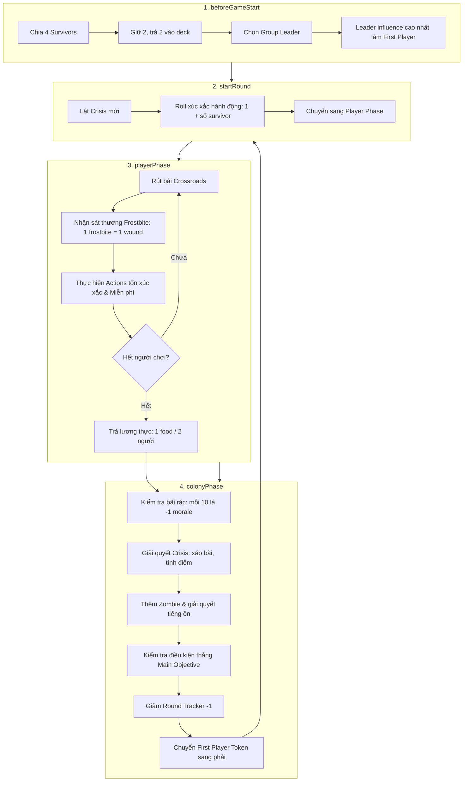

# ĐẶC TẢ TOÀN BỘ CÁC THAO TÁC TRONG GAME "DEAD OF WINTER"
*(Action Architecture & Invariant Specifications)*

Tài liệu này chuẩn hóa toàn bộ các hành động, quy tắc và chuỗi phản ứng khả thi trong luật game *Dead of Winter* dựa trên file luật `GAME_RULE.md`.

---

## 🏛️ TRIẾT LÝ KIẾN TRÚC PHÂN TẦNG (ACTION LAYERING)

Hệ thống được chia thành 4 tầng rõ rệt:

```
┌─────────────────────────────────────────────────────────────┐
│ TẦNG 3: TIẾN TRÌNH TRÒ CHƠI & GIAI ĐOẠN (GAME PHASES)        │
│ (Setup, Start Round, Player Turns Order, Colony Phase Steps) │
└──────────────────────────────┬──────────────────────────────┘
                               │ điều phối
┌──────────────────────────────▼──────────────────────────────┐
│ TẦNG 2: HÀNH ĐỘNG CỦA NGƯỜI CHƠI (PLAYER ACTIONS)           │
│ (Tốn xúc xắc: Attack, Search, Barricade, Clean, Attract...)  │
│ (Miễn phí: Move, Play Card, Contribute, Hand off, Request)  │
└──────────────────────────────┬──────────────────────────────┘
                               │ cấu thành từ
┌──────────────────────────────▼──────────────────────────────┐
│ TẦNG 1: QUY TẮC BẤT BIẾN TỰ NHIÊN (AUTOMATIC INVARIANTS)     │
│ (Được tích hợp NGAY BÊN TRONG hành động nguyên tử)          │
│ - receiveWound >= 3 -> Tự động trigger handleSurvivorDeath  │
│ - spawnZombie -> Tự động trừ Barricade hoặc Overrun         │
│ - handleSurvivorDeath -> Trừ morale, rơi đồ, kiểm tra last  │
│ - Starvation -> Trừ morale theo số token tích lũy           │
└──────────────────────────────┬──────────────────────────────┘
                               │ xây dựng trên
┌──────────────────────────────▼──────────────────────────────┐
│ TẦNG 0: CÁC THAO TÁC NGUYÊN TỬ (PRIMITIVE ATOMIC ACTIONS)   │
│ (Thao tác đơn lẻ trên State, là Single Source of Truth)     │
│ - Deck / Hand / Waste / Reveal                              │
│ - Survivor / Wound / Move status                            │
│ - Location / Zombie / Barricade / Noise / Food              │
│ - Dice / Morale / Round                                     │
└─────────────────────────────────────────────────────────────┘
```

---

## 🧱 TẦNG 0 & 1: CÁC THAO TÁC NGUYÊN TỬ & QUY TẮC BẤT BIẾN TỰ NHIÊN
*(Primitive Actions & Natural Invariants)*

Đây là những thao tác nền tảng nhất. **Mọi thay đổi dữ liệu trong game bắt buộc phải thông qua các hàm này.**

---

### Nhóm 1: Quản lý Nhân vật & Vết thương (Survivor & Wounds)

#### 1. `spawnSurvivor(survivorId, playerId, location)`
* **Ý nghĩa:** Đặt một nhân vật mới lên bàn chơi và gán vào nhóm của người chơi.
* **Điều kiện (Precondition):**
  * `survivorId` hợp lệ, người chơi tồn tại và survivorId có trong bộ bài survivor
  * Nếu vào Colony: tổng số `survivor + helpless < maxSurvivor`.
  * Nếu vào Location ngoài: `survivorNumber < maxSurvivorNumber`.
* **Biến đổi State:**
  * Thêm `survivorId` vào `public.players[playerId].survivorList`.
  * Khởi tạo `public.survivorInfo[survivorId]` với: `location`, `belongPlayer`, `wound = []`, `hasMoved = false`, `equippedItems = []`.
  * Tăng số đếm tại địa điểm (`colony.survivor++` hoặc `loc.survivorNumber++`).
  * Loại bỏ lá bài survivor đó ở chồng bài survivor.
* **Lưu ý:** Không can thiệp vào Morale.

#### 2. `removeSurvivor(survivorId)`
* **Ý nghĩa:** Gỡ nhân vật khỏi bản đồ và danh sách của người chơi (dành cho trường hợp bị loại bỏ mà không chết, hoặc bước dọn dẹp).
* **Biến đổi State:**
  * Giảm số đếm tại địa điểm hiện tại.
  * Xóa khỏi `survivorList` của người chơi.
  * Xóa khỏi `public.survivorInfo`.
  * survivorId sẽ chuyển sang removeSurvivorDeck 
* **Lưu ý:** Theo dòng 176 `GAME_RULE.md`: *"Some cards may remove survivors from the game but not kill them. In this case morale is not lowered."* Do đó hàm này **không giảm Morale**.

##### 3. `receiveWound(survivorId, wound: 'wound' | 'frostbite')`
* **Ý nghĩa:** Nhân vật nhận 1 vết thương thường hoặc 1 vết tê cóng.
* **BẤT BIẾN TỰ NHIÊN (Single Source of Truth):**
  * Đưa vết thương vào `survivor.wound`. Mỗi vết `frostbite` được tính là 1 vết thương khi đếm số lượng.
  * **KIỂM TRA NGƯỠNG TỬ VONG:** Nếu `survivor.wound.length >= survivorHp` (mặc định 3 máu hoặc 4 máu theo cấu hình nhân vật), **TỰ ĐỘNG GỌI `handleSurvivorDeath(survivorId)`**.
* **Hệ quả:** Bất kể vết thương đến từ đâu (gieo xúc xắc Exposure, Frostbite đầu lượt, bị người chơi khác chém, hoặc Admin chỉnh sửa), nhân vật **luôn chết đúng luật khi chạm mốc tích đủ vết thương**.

#### 4. `removeWound(survivorId, woundType, amount)` / `removeAllWound(survivorId)`
* **Ý nghĩa:** Chữa trị/loại bỏ vết thương khỏi nhân vật (dùng thuốc, kỹ năng).
* **Biến đổi State:** Giảm số phần tử trong mảng `survivor.wound`.

#### 5. `markAsMoved(survivorId)` / `markAsNotMoved(survivorId)`
* **Ý nghĩa:** Đánh dấu nhân vật đã di chuyển trong lượt hiện tại, hoặc hồi lại lượt di chuyển khi bắt đầu vòng mới.

#### 6. `handleSurvivorDeath(survivorId)` *(Compound Invariant: Xử lý cái chết)*
* Gọi `removeSurvivor` để gỡ khỏi bàn cờ, đồng thời thực thi toàn bộ quy trình tử vong.
* **Ý nghĩa:** Quy trình chuẩn xác khi bất kỳ nhân vật nào tử vong (do đủ vết thương, do Bitten, do Overrun, do lá bài giết).
* **Quy tắc bắt buộc theo dòng 161-172 `GAME_RULE.md`:**
  1. Giảm Morale: `changeMorale(-1)` (trừ khi người chơi điều khiển đang bị Exile thì không giảm Morale).
  2. Đưa thẻ bài nhân vật vào `removedSurvivor`: `putCardToDeck('removedSurvivor', [survivorId], 'top')`.
  3. Xử lý trang bị đang mặc (`equippedItems`):
     * Nếu chết ở **Colony**: Trả toàn bộ trang bị về tay người chơi (`addCardToHand`).
     * Nếu chết ở **Location ngoài**: Xáo toàn bộ trang bị vào cọc bài của địa điểm đó (`putCardToDeck(loc, items, 'shuffle')`).
  4. Gỡ nhân vật khỏi bàn cờ: `removeSurvivor(survivorId)`.
  5. **Kiểm tra luật "Người sống sót cuối cùng chết" (Last Survivor Killed):**
     * Nếu `player.survivorList.length === 0`:
       * Toàn bộ bài trên tay bị xóa khỏi game: `removeCardFromHand` -> đưa vào `removedItem`.
       * Rút 1 survivor mới từ `survivorDeck` (nếu deck rỗng thì hành động vô hiệu).
       * **Kích hoạt trạng thái Pending:** `pending = { type: 'selectNewSurvivorPlacement', playerId, newSurvivorId }`.
         * Nếu là người chơi bình thường và Colony còn chỗ: Có thể đặt vào Colony hoặc chọn vị trí ngoài hợp lệ.
         * Nếu Colony đã đầy hoặc người chơi đang bị Exile: Bắt buộc phải chọn 1 Location ngoài còn chỗ trống. Nếu tất cả các nơi đều đầy (bất khả thi) thì hành động đặt survivor vô hiệu.
         * Người chơi đó tự động nhận nhân vật mới này làm Group Leader mới.
         * Sau khi resolve xong trạng thái pending này, hệ thống yêu cầu các người chơi khác confirm để tiếp tục luồng game.
       * Secret objective được giữ nguyên.
  6. **Chọn lại Group Leader:** Nếu survivor bị giết là Group Leader nhưng người chơi vẫn còn survivor khác:
     * Kích hoạt `pending = { type: 'chooseNewLeader', playerId }` để người chơi chọn Leader mới từ các survivor còn sống của mình.
     * Sau khi resolve, các người chơi khác confirm.

* Hàm `removeHelplessSurvivor` là hàm cấp dưới, chịu trách nhiệm trừ số lượng helplessSurvivor.
* **Biến đổi State:**
  * Giảm `colony.helpless` đi `amount`.
  * Giảm Morale tương ứng: `changeMorale(-amount)`.
* **Ý nghĩa:** Giết người sống sót bất lực tại Colony (do Overrun, hiệu ứng Crisis, sự kiện).

#### 7. `killHelplessSurvivor(amount)`
* Tái sử dụng hàm `removeHelplessSurvivor(amount)`.
* Giảm Morale tương ứng với số helpless bị giết.
---

### Nhóm 2: Quản lý Zombie, Rào chắn & Tiếng ồn (Zombies, Barricades & Noise)

#### 8. `spawnZombieAtColony(amount, entranceIndex?)` & `spawnZombieAtLocation(locationId, amount)`
* **Ý nghĩa:** Đặt zombie tại cổng Colony hoặc tại địa điểm ngoài.
* **Nguyên tắc cốt lõi tại Colony - LUÔN XOAY VÒNG BẮT ĐẦU TỪ CỔNG 1:**
  * Mỗi khi thêm `amount` zombie vào Colony, hệ thống luôn chạy vòng lặp bắt đầu từ cổng số 1 (cổng 1 -> 2 -> 3 -> 4 -> 5 -> 6 -> 1...).
  * Tái sử dụng trực tiếp logic đặt zombie tại cổng đơn: `spawnSingleZombieAtColonyEntrance`.
  * Nếu truyền `entranceIndex` cụ thể: Cho phép đặt tại cổng chỉ định (dành cho các hiệu ứng đặc thù).
* **Quy tắc giải quyết từng zombie được thêm:**
  1. **Kiểm tra Rào chắn (Barricade):** Nếu cổng có `barricade > 0` -> Trừ 1 barricade, **triệt tiêu zombie này** (không sinh zombie).
  2. **Kiểm tra Sức chứa:** Nếu còn slot trống (`zombie < maxZombieCapacity`) -> Tăng `zombie++`.
  3. **Quá tải (Overrun):** Nếu hết chỗ và không còn rào chắn:
     * Không tăng zombie.
     * Tìm nhân vật có `influent` thấp nhất tại địa điểm đó -> Gọi `handleSurvivorDeath(lowestSurvivorId)`.
     * Nếu không có survivor mà có helpless (ở Colony) -> Gọi `killHelplessSurvivor(1)`.
     * Nếu không có ai tại địa điểm đó -> Zombie bị loại bỏ, không có gì xảy ra.

#### 9. `removeZombieAtColony(entranceIndex, amount)` & `removeZombieAtLocation(locationId, amount)`
* **Ý nghĩa:** Tiêu diệt zombie (khi tấn công, dùng súng, kỹ năng).
* **Biến đổi State:** Giảm số đếm zombie tại vị trí tương ứng.

#### 10. `buildBarricadeAtColony(entranceIndex, amount)` & `buildBarricadeAtLocation(locationId, amount)`
* **Ý nghĩa:** Dựng rào chắn.
* **Bất biến (Invariant):** Tổng số `barricade + zombie` không được vượt quá `maxZombieCapacity`. Nếu đầy thì không thể xây tiếp.

#### 11. `removeBarricadeAtColony` & `removeBarricadeAtLocation`
* **Ý nghĩa:** Phá hủy rào chắn (khi zombie cắn vỡ rào, hoặc dọn rào).

#### 12. `addNoise(locationId, amount)` & `removeNoise(locationId, amount)`
* **Ý nghĩa:** Thêm/xóa token tiếng ồn tại 6 địa điểm ngoài (tối đa bằng `maxNoise` = 4).

---

### Nhóm 3: Quản lý Bài & Cọc bài (Cards, Hands & Decks)

#### 13. `addCardToHand(playerId, cards)` & `removeCardFromHand(playerId, cards)`
* **Ý nghĩa:** Thao tác duy nhất được phép thêm/bớt bài trên tay người chơi.
* **Bất biến:** Đồng bộ tự động giữa `private.players[pId].hand` và `public.players[pId].handSize` (Loại bỏ luôn player.handSize có thể tự tính toán được)
Có thể thêm mọi loại bài và giữ trên tay.

#### 14. `draw(deckId, toPlayerId)`
* **Ý nghĩa:** Rút lá bài trên cùng từ cọc bài.
* **Bất biến:**
  * Logic lật bài (Reveal): Khi reveal bài trên đỉnh bộ bài, thứ tự các lá bài trong bộ bài được giữ nguyên. Khi rút bài, nếu đỉnh bộ bài đang ở trạng thái reveal thì sẽ lấy đúng lá bài đã được tiết lộ đó.
  * Sau khi lấy lá bài ra khỏi deck, gọi `addCardToHand(toPlayerId, [card])`.

#### 15. `putCardToDeck(deckId, cards, pos: 'top' | 'bottom' | 'shuffle', fromPlayerId?)`
* **Ý nghĩa:** Đặt bài vào cọc (trên đầu, dưới đáy, hoặc nhét vào xáo lại).
* **Bất biến:** Nếu có `fromPlayerId`, phải xác minh bài có trên tay người chơi đó hay không và tự gọi `removeCardFromHand`.

#### 16. `moveCardBetweenDecks(fromDeck, toDeck, cards, pos)`
* **Ý nghĩa:** Di chuyển bài trực tiếp giữa 2 cọc bài (ví dụ: `crisisContribution` -> `removedItem`).

#### 17. `reveal(deckId, amount)` & `clearReveal(deckId, returnPos: 'bottom' | 'top')`
* **Ý nghĩa:** Lật bài xem tạm thời từ trên đầu cọc bài (dùng khi Search hoặc kích hoạt hiệu ứng bài).
* **Bất biến:**
  * `reveal`: Tiết lộ `amount` lá bài trên đỉnh bộ bài nhưng giữ nguyên thứ tự của chúng.
  * Trong trường hợp hiệu ứng chọn bài (như Search): Người chơi chọn 1 lá vào tay, các lá còn lại trong danh sách reveal sẽ được chuyển về vị trí chỉ định (thường là đáy bộ bài `'bottom'`).
  * `clearReveal`: Đặt lại trạng thái `reveal = []` (rỗng). Khi danh sách reveal đã rỗng (`reveal = []`), các hiệu ứng tương tác hoặc lấy bài từ chồng bài reveal sẽ bị vô hiệu hóa. 

#### 18. `equipCard(survivorId, itemCard)` & `unequipCard(survivorId, itemCard, returnToPlayerId?)`
* **Ý nghĩa:** Mặc trang bị lên nhân vật hoặc tháo trang bị.
* **Bất biến:**
  * `equipCard`: Lấy thẻ từ tay người sở hữu nhân vật (thông qua `removeCardFromHand`) rồi đưa vào `equippedItems`.
  * `unequipCard`: Gỡ khỏi `equippedItems` và trả về tay người chơi (thông qua `addCardToHand`).

#### 19. `transferEquip(fromSurvivorId, toSurvivorId, equipId)`
* **Ý nghĩa:** Chuyển trang bị giữa 2 nhân vật (phải cùng địa điểm).

#### 20. `addCardToWaste(cards)` & `removeCardFromWaste(cards)`
* **Ý nghĩa:** Thêm bài vào bãi rác Colony (khi chơi bài item) hoặc dọn rác (Clean Waste) -> gọi hàm thêm bài từ deck. Lưu ý chỉ có thẻ có thuộc tính waste là pile thì mới bỏ vào chồng bài bỏ. Còn lại sẽ bỏ vào chồng bài removeFromPlay

---

### Nhóm 4: Xúc xắc & Chỉ số toàn cục (Dice, Scale & Supply)

#### 21. `spendActionDice(playerId, dieIndex, requireMin)`
* **Ý nghĩa:** Chi tiêu 1 viên xúc xắc chưa dùng có giá trị `>= requireMin`.
* **Biến đổi State:** Chuyển viên xúc xắc từ `die.unused` sang `die.used`.

#### 22. `changeActionDie(playerId, dieIndex, newValue)`
* **Ý nghĩa:** Thay đổi giá trị của 1 viên xúc xắc (khi ăn Food token, hiệu ứng thẻ bài).

#### 23. `rerollActionDie(playerId, dieIndex)` & `rerollAllActionDie(playerId)`
* **Ý nghĩa:** Đổ lại 1 viên hoặc đổ toàn bộ xúc xắc đầu vòng (1 cơ bản + 1 cho mỗi survivor).


#### 24. `addFood(amount)` / `removeFood(amount)`
* **Ý nghĩa:** Tăng/giảm kho lương thực Colony.

#### 25. `addStarvation(amount)` / `removeStarvation(amount)`
* **Ý nghĩa:** Thêm token đói ăn (khi thiếu lương thực ở Colony Phase).

#### 26. `changeMorale(delta)` & `changeRound(delta)`
* **Ý nghĩa:** Tăng/giảm sĩ khí và số vòng chơi còn lại.
* **Bất biến:** Nếu `morale <= 0` hoặc `leftRound <= 0`, lập tức kích hoạt sự kiện kết thúc ván đấu (`events.endGame`).

#### 27. `exilePlayer(targetPlayerId)`
* **Ý nghĩa:** Trục xuất một người chơi theo kết quả bỏ phiếu.
* **Quy tắc bắt buộc theo dòng 206-221 `GAME_RULE.md`:**
  1. Gán cờ `isExiled = true` cho người chơi.
  2. Rút 1 lá Exile Objective: `draw('exile', targetPlayerId)`.
  3. Di chuyển toàn bộ survivor của người chơi đó đang ở Colony ra các địa điểm bên ngoài.
  4. Người chơi này bị cấm: đóng góp Crisis, bỏ phiếu, dùng Food token (phải dùng Food card).
  5. Khi survivor của người bị Exile chết, Colony không bị mất morale.

* addActionDie(playerId) -> Thêm xúc sắc hành động vào ô chưa hành động, xúc xắc này sẽ tự động được reroll.
* getSixSideDie() -> lấy thông tin về lần tung xúc xắc 6 mặt -> nhiệm vụ là cập nhật log vì sẽ có các trường hợp yêu cầu đủ xí ngầu để xác nhận
* getExposureDieResult() -> tương tự như là getSixSideDie() -> nhưng là lấy thông tin của xúc sắc mạo hiểm.
Hai hàm đổ xúc sắc không làm thay đổi gameState -> nhưng gửi tín hiệu để client hiển thị hoạt ảnh đổ xúc sắc.
---

## 🎮 TẦNG 2: HÀNH ĐỘNG CỦA NGƯỜI CHƠI (PLAYER ACTIONS)
*(Mọi hành động ở tầng này ĐỀU ĐƯỢC TÁI CHẾ TỪ TẦNG 0 & 1, không tự thay đổi state trực tiếp)*

---

### A. Các hành động tốn Xúc xắc Hành động (Action Die Actions)

| Tên hành động | Chi phí xúc xắc | Điều kiện (Preconditions) | Chuỗi thao tác nguyên tử cấu thành |
| :--- | :--- | :--- | :--- |
| **`playerAttackZombie`** | 1 xúc xắc `>= powerIndex` của survivor | Survivor ở cùng vị trí với zombie cần đánh. | 1. `spendActionDice`<br>2. `removeZombieAtColony` hoặc `removeZombieAtLocation`<br>3. Nếu không có passive `NO_EXPOSURE_WHEN_ATTACK` -> Đổ xúc xắc mạo hiểm: gọi `applyExposureResult`. |
| **`playerAttackSurvivor`** | 1 xúc xắc `>= powerIndex` của survivor mình | Mục tiêu ở cùng địa điểm với survivor tấn công (khác người chơi). | 1. `spendActionDice`<br>2. Gieo lại viên xúc xắc vừa tiêu: nếu `<= powerIndex` mục tiêu:<br> - `transferCardBetweenPlayers` (cướp ngẫu nhiên 1 lá bài từ tay người sở hữu mục tiêu nếu họ còn bài trên tay - thực hiện trước khi gây thương tích).<br> - `receiveWound(targetId, 'wound')` (tự động kích hoạt tử vong nếu tích đủ vết thương). |
| **`playerSearch`** | 1 xúc xắc `>= searchIndex` của survivor | Survivor ở 6 địa điểm bên ngoài (không search ở Colony). | 1. `spendActionDice`<br>2. `reveal(loc, 1)`<br>3. Đặt trạng thái `pending = { type: 'drawFromReveal', ... }` để người chơi chọn giữ bài hoặc làm ồn. |
| **`playerSearchMakeNoise`** | Miễn phí (trong khi search) | Còn slot noise trống tại địa điểm (`noise < maxNoise`). | 1. `addNoise(loc, 1)`<br>2. `reveal(loc, 1)`<br>3. Cập nhật danh sách thẻ trong `pending`. |
| **`playerFinishSearch`** | Miễn phí (trong khi search) | Chọn 1 lá trong các lá đã reveal. | 1. Lấy lá chọn vào tay: `addCardToHand(playerId, [keptCard])`<br>2. Trả các lá còn lại về đáy deck: `clearReveal(loc, 'bottom')`<br>3. Xóa `pending = null`. |
| **`playerBarricade`** | 1 xúc xắc bất kỳ (>= 1) | Vị trí có survivor của mình; còn slot rào chắn (`barricade + zombie < maxZombieCapacity`). | 1. `spendActionDice`<br>2. `buildBarricadeAtColony` hoặc `buildBarricadeAtLocation`. |
| **`playerCleanWaste`** | 1 xúc xắc bất kỳ (>= 1) | Người chơi phải có ít nhất 1 survivor ở Colony; `colony.waste.length > 0`. | 1. `spendActionDice`<br>2. Lấy 3 lá rác đầu tiên: `removeCardFromWaste(cards)`<br>3. Đưa vào cọc loại bỏ: `putCardToDeck('removedItem', cards, 'bottom')`. |
| **`playerAttractZombies`** | 1 xúc xắc bất kỳ (>= 1) | Vị trí đích là vị trí của survivor thực hiện hành động. | 1. `spendActionDice`<br>2. Gỡ 1 hoặc 2 zombie ở vị trí nguồn: `removeZombie`<br>3. Đặt zombie vào vị trí đích: `spawnZombie` (tự động trừ barricade hoặc overrun nếu quá tải). |

---

### B. Các hành động Miễn phí (Free Actions)

| Tên hành động | Điều kiện (Preconditions) | Chuỗi thao tác nguyên tử cấu thành |
| :--- | :--- | :--- |
| **`playerMoveSurvivor`** | Survivor chưa di chuyển trong lượt (`!hasMoved`); vị trí đích còn chỗ trống. | 1. `moveSurvivor(survivorId, to)`<br>2. `markAsMoved(survivorId)`<br>3. Nếu dùng Fuel card: `removeCardFromHand` -> `addCardToWaste`<br>4. Nếu không dùng Fuel & không có passive `NO_EXPOSURE_WHEN_MOVING`: Đổ Exposure -> gọi `applyExposureResult`. |
| **`playerPlayCard`** | Thẻ bài có trên tay người chơi. | - Nếu là **Trang bị**: `equipCard(survivorId, cardId)`<br>- Nếu là **Thẻ thường**: `removeCardFromHand` -> `addCardToWaste` (hoặc `putCardToDeck('removedItem')` nếu người chơi bị Exile). |
| **`playerSpendFoodToken`** | `colony.food > 0`; viên xúc xắc chưa dùng có giá trị `< 6`; **người chơi không bị Exile**. | 1. `removeFood(1)`<br>2. `changeActionDie(dieIndex, currentVal + 1)`. |
| **`playerSpendFoodCard`** | Có thẻ Food trên tay; viên xúc xắc chưa dùng có giá trị `< 6` (áp dụng cho cả người chơi bình thường lẫn người chơi bị Exile). | 1. `removeCardFromHand(playerId, [foodCardId])`<br>2. Nếu bị Exile: `putCardToDeck('removedItem', [foodCardId], 'bottom')`<br>Nếu không bị Exile: `addCardToWaste([foodCardId])`<br>3. `changeActionDie(dieIndex, currentVal + 1)`. |
| **`playerContributeToCrisis`** | Bài có trên tay; người chơi **không bị Exile**. | 1. `removeCardFromHand(cards)`<br>2. `putCardToDeck('crisisContribution', cards, 'bottom')`. |
| **`playerHandOff`** | 2 survivor cùng một địa điểm; survivor cho đang mặc trang bị đó. | `transferEquip(fromSurvivorId, toSurvivorId, itemId)`. |
| **`playerRequestCard`** | Người cho đồng ý giao bài. | `transferCardBetweenPlayers(fromPlayerId, toPlayerId, cardId)` (người nhận phải dùng ngay). |
| **`initiateVoteExile`** | Mục tiêu chưa bị Exile; chưa có vote nào đang diễn ra. | Đặt trạng thái `pending = { type: 'vote', targetPlayerId, ... }`. |

---

## ⚡ TẦNG PHẢN ỨNG: XỬ LÝ BIẾN CỐ & HIỆU ỨNG TRIGGER
*(Reactive Events & Resolutions)*

Các biến cố xảy ra ngoài lượt bình thường hoặc ngắt ngang hành động:

### 1. Phản ứng Lây nhiễm Bị cắn (Bite Spread Reaction)
* **Kích hoạt:** Khi một survivor gieo trúng mặt **Bitten** trên xúc xắc Exposure.
  * Nếu survivor có passive `CHANGE_BITE_TO_WOUND`: Biến kết quả Bitten thành 1 wound bình thường (`receiveWound`), không tử vong và không kích hoạt lây nhiễm.
* **Diễn biến theo dòng 124-133 `GAME_RULE.md`:**
  1. Survivor bị cắn tử vong ngay lập tức: gọi `handleSurvivorDeath(survivorId)`.
  2. Bệnh dịch tìm survivor có `influent` thấp nhất cùng địa điểm đó (bỏ qua những survivor có passive `IGNORE_BITE_SPREADING`). **TUYỆT ĐỐI KHÔNG lây sang Helpless Survivor.**
  3. Nếu tìm thấy survivor tiếp theo -> Chặn lượt chơi và đặt trạng thái:
     `pending = { type: 'biteSpread', survivorId: targetId, location }`.
     *(Nếu không còn survivor nào khác tại địa điểm đó, chuỗi lây nhiễm dừng lại ngay lập tức).*
  4. Người chơi sở hữu survivor mục tiêu bắt buộc phải chọn 1 trong 2 hành động:
     * **Lựa chọn A: `resolveBiteAcceptDeath()` (Chấp nhận hy sinh):**
       * Gọi `handleSurvivorDeath(targetId)`.
       * Chuỗi lây nhiễm dừng lại hoàn toàn. Xóa `pending = null`.
     * **Lựa chọn B: `resolveBiteRollRisk()` (Đổ xúc xắc mạo hiểm):**
       * Gieo xúc xắc Exposure:
         * Nếu ra **Blank**: Kháng nhiễm thành công! Dừng lây nhiễm, xóa `pending = null`.
         * Nếu ra **bất kỳ kết quả nào khác** (Wound / Frostbite / Bitten): Được tính là Bitten! Gọi `handleSurvivorDeath(targetId)` và **tiếp tục lây sang người có influence thấp tiếp theo** (lặp lại bước 2 & 3).

### 2. Phản ứng Biểu quyết Trục xuất (Simultaneous Vote Resolution)
* **Kích hoạt:** Sau khi một người chơi gọi `initiateVoteExile(targetId)`.
* **Diễn biến:**
  1. Tất cả người chơi không bị Exile biểu quyết: `castVote('yes' | 'no')`.
  2. Khi mọi người chơi đủ điều kiện đã vote:
     * Nếu số phiếu YES > số phiếu NO -> Trục xuất thành công: gọi `exilePlayer(targetId)`.
     * Nếu hòa phiếu -> Người giữ First Player Token quyết định kết quả.
     * Xóa `pending = null`.

---

## 🔄 TẦNG 3: TIẾN TRÌNH VÒNG CHƠI (GAME PHASES)
*(Điều phối các hành động theo 4 giai đoạn chuẩn)*



---

## 📊 MA TRẬN ÁNH XẠ: HÀNH ĐỘNG CẤP CAO VÀ THAO TÁC NGUYÊN TỬ
*(High-Level Action to Primitive Dependency Matrix)*

| Hành động gọi từ UI / Game Flow | Các thao tác nguyên tử (Primitive Actions) bắt buộc phải gọi |
| :--- | :--- |
| **`receiveWound`** *(bất kỳ đâu gọi)* | Tự kiểm tra `survivor.wound.length >= 3` -> gọi `handleSurvivorDeath` |
| **`applyExposureResult`** | Gọi `receiveWound` (nếu wound/frostbite); gọi `handleSurvivorDeath` + set `pending.biteSpread` (nếu bitten) |
| **`playerMoveSurvivor`** | `moveSurvivor` -> `markAsMoved` -> (`removeCardFromHand` + `addCardToWaste` nếu có Fuel) -> `applyExposureResult` |
| **`playerPlayCard`** | `equipCard` (nếu equip); hoặc `removeCardFromHand` + `addCardToWaste` (nếu thẻ thường) |
| **`playerAttackZombie`** | `spendActionDice` -> `removeZombieAtColony` / `removeZombieAtLocation` -> `applyExposureResult` (nếu không có passive miễn trừ) |
| **`playerAttackSurvivor`** | `spendActionDice` -> gieo lại xúc xắc -> `transferCardBetweenPlayers` (cướp bài trước nếu có) -> `receiveWound` (tự động check chết) |
| **`playerSpendFoodCard`** | `removeCardFromHand` -> (`putCardToDeck('removedItem')` nếu Exile, hoặc `addCardToWaste` nếu bình thường) -> `changeActionDie` |
| **`playerAttractZombies`** | `spendActionDice` -> `removeZombie` (ở nguồn) -> `spawnZombie` (ở đích, tự động xử lý rào chắn / overrun) |
| **`payFood`** | `removeFood` (nếu đủ); hoặc `addStarvation` + `changeMorale` (nếu thiếu) |
| **`resolveCrisis`** | `moveCardBetweenDecks('crisisContribution', 'removedItem')` -> `changeMorale` / `addStarvation` / `spawnZombie` nếu thất bại |
| **`addColonyZombies`** | `spawnZombieAtColony` (chia xoay vòng cổng 1->6) -> `spawnZombieAtLocation` -> giải quyết noise |
| **`chooseStartingSurvivors`** | `putCardToDeck('survivor', removed)` -> `removeSurvivor(id)` |
| **`rollRoundActionDice`** | `rerollAllActionDie(playerId)` cho từng người chơi |
| **`exilePlayer`** | Gán `isExiled = true` -> `draw('exile')` -> `moveSurvivor` ra ngoài Colony |

---

## 📌 KẾT LUẬN KIẾN TRÚC

Với đặc tả này:
1. **Không có bất kỳ sự trùng lặp code hay phân mảnh logic nào:** Khi `receiveWound` tự kích hoạt chết, mọi nơi gây sát thương đều đồng nhất. Khi `spawnZombie` tự trừ rào chắn và tự overrun, mọi nơi sinh zombie đều tuân thủ luật.
2. **Admin Sandbox Mode an toàn tuyệt đối:** Admin kích hoạt bất kỳ atomic move nào trên UI (cộng wound, spawn zombie, v.v.), hệ thống vẫn đảm bảo đúng luật tự nhiên mà không bao giờ bị rơi vào trạng thái bất nhất (inconsistent state).

### 3. Hệ thống Nhãn Hiệu ứng Bị động (Tag-based Passive Effects)
Các hiệu ứng bị động được chuẩn hóa bằng nhãn mã hóa (Enum Tags), tuyệt đối không hardcode theo tên nhân vật:
* **`IGNORE_BITE_SPREADING`**: Nhân vật được miễn nhiễm khỏi chuỗi lây lan Bitten (không bị chọn làm mục tiêu kế tiếp).
* **`CHANGE_BITE_TO_WOUND`**: Khi gieo trúng mặt Bitten trên xúc xắc Exposure, tự động chuyển thành 1 vết thương thường (`wound`), không tử vong ngay và không kích hoạt lây lan.
* **`CHANGE_FROSTBITE_TO_WOUND`**: Khi gieo trúng Frostbite, tự động đổi thành 1 vết thương thường.
* **`NO_EXPOSURE_WHEN_ATTACK`**: Miễn đổ xúc xắc Exposure khi thực hiện hành động tấn công Zombie (`playerAttackZombie`).
* **`NO_EXPOSURE_WHEN_MOVING`**: Miễn đổ xúc xắc Exposure khi thực hiện hành động di chuyển (`playerMoveSurvivor`).

### 4. Cơ chế Trigger Tương tác & Admin Mode (PLAYER_TRIGGER)
* **Tất cả điều kiện kích hoạt chuyển thành `PLAYER_TRIGGER`**:
  * Toàn bộ `Condition`, `Cost`, và `ActiveEffect` của Kỹ năng (Skills), Thẻ Sự kiện (Crossroads), Khủng hoảng (Crises), và Mục tiêu (Objectives) đều mang kiểu `PLAYER_TRIGGER`. Không có logic ngầm tự động kích hoạt: người chơi (hoặc đối thủ cầm lá bài Crossroads) tự nhận thấy điều kiện thỏa mãn và chủ động kích hoạt.
  * Khi kích hoạt, hệ thống chuyển sang trạng thái tương tác (`pending`) hoặc mở Admin Mode để người chơi tự giải quyết theo thỏa thuận.
* **Quy trình Thực thi PLAYER_TRIGGER (Lưu Snapshot & Biểu quyết):**
  1. **Lưu Snapshot:** Trước khi kích hoạt chế độ này, hệ thống **bắt buộc tạo một bản sao lưu (Snapshot)** của toàn bộ `GameState` tại thời điểm đó.
  2. **Thực thi:** Người chơi sở hữu hiệu ứng vào Admin Mode để tự do điều chỉnh các chỉ số bàn cờ (thêm/bớt máu, zombie, di chuyển bài...) phù hợp với mô tả của lá bài phức tạp hoặc Crossroads.
  3. **Biểu quyết kiểm chứng:** Sau khi người chơi kết thúc điều chỉnh, hệ thống chuyển sang `pending = { type: 'voteAdminAction', ... }` để tất cả các người chơi khác vote xác nhận tính hợp lệ.
  4. **Xử lý kết quả:**
     * **Nếu Vote Thông qua:** Trạng thái mới được áp dụng chính thức, hủy bỏ Snapshot.
     * **Nếu Vote Thất bại (Bị từ chối):** Hệ thống **TỰ ĐỘNG ROLLBACK** trạng thái game về lại đúng Snapshot ban đầu, tránh việc bàn cờ bị chỉnh sửa sai lệch.

### 5. Nguyên tắc Đồng thuận Trạng thái Pending (Pending Confirmation)
* Toàn bộ các trạng thái `pending` ngắt quãng cần người chơi ra quyết định (chọn vị trí đặt Survivor mới, chọn lại Group Leader, v.v.): sau khi người chơi đó resolve xong lựa chọn của mình, hệ thống sẽ chuyển sang bước **Confirm từ các người chơi còn lại** để đảm bảo tính minh bạch trước khi tiếp tục luồng game.

### 6. Quy ước Định danh Thẻ bài (Card ID Convention)
* Các lá bài được gán ID đại diện theo mã loại thẻ (Type ID), ví dụ lá starter medicine có id: `med_starter`.
* Nếu bộ bài có 5 lá giống nhau, mảng dữ liệu sẽ chứa 5 phần tử cùng tên: `['med_starter', 'med_starter', 'med_starter', 'med_starter', 'med_starter']` (thay vì phải sinh `med_starter_1`, `med_starter_2`...).
* Đối với các thẻ trang bị (Equipped Items), hệ thống xem các lá cùng ID là đồng nhất (stateless); mọi sự phân định cụ thể khi tháo/chuyển trang bị để người chơi tự xử lý.